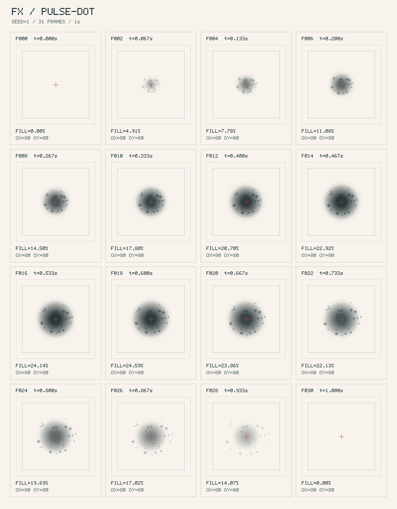
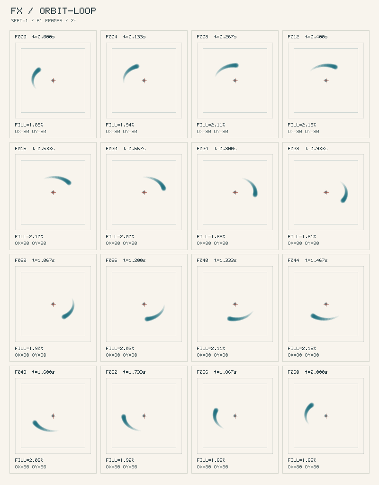

# fx-skill-kit

**Give procedural FX a visible feedback loop.**

Draft a tiny JavaScript effect, check its behavior, and render a contact sheet you can actually judge. fx-skill-kit gives humans and coding agents the same loop: **Draft → Check → Render → Look → Refine**.

It catches unseeded randomness, pixels spilling into the frame edge, and broken loop seams. Every contact-sheet cell shows a frame number, elapsed seconds, fill percentage, safe-area guide, and origin crosshair. The JSON beside it keeps full-precision timings and frame statistics.

## Try it

Requires Node.js 20 or newer. No package installation or build step.

```sh
npm test
npm run check
npm run render
# Open examples/out/pulse-dot/contact.png and examples/out/orbit-loop/contact.png
```

Create your own effect, then check and inspect it:

```sh
npm run new -- my-pulse
npm run check -- examples/fx/my-pulse.js --seed 7
npm run render -- examples/fx/my-pulse.js --seed 7
```

## What you see

**Pulse dot:** a soft, seeded ink pulse that blooms and fades.



**Orbit loop:** a particle and fading trail returning to their starting phase.



Read each sheet left to right, top to bottom. The crosshair anchors the effect's origin; fill% describes the effect before annotations. First and last cells include both timeline endpoints. Add `--frames 31` to inspect more moments or `--out path/to/review` to choose the output directory.

## Preview in motion

```sh
node gallery/serve.mjs
# Open http://127.0.0.1:8080/gallery/
```

The static gallery loads the same ES modules onto a canvas, with seed selection, replay, pause, and origin guides. Any local static server rooted at this repo also works. No build step or hosted deployment is needed.

See [AUTHORING.md](docs/AUTHORING.md) for the metadata, RGBA buffer, seed, and check contracts. Agents can follow [the FX authoring skill](skills/fx-authoring/SKILL.md) to keep visual inspection in the loop.

Private project. Core tools use pure ESM and Node built-ins, with zero runtime dependencies.
