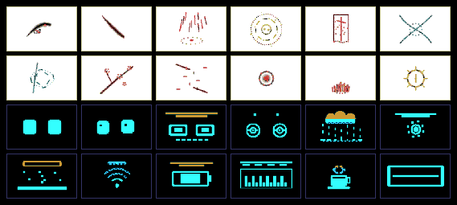
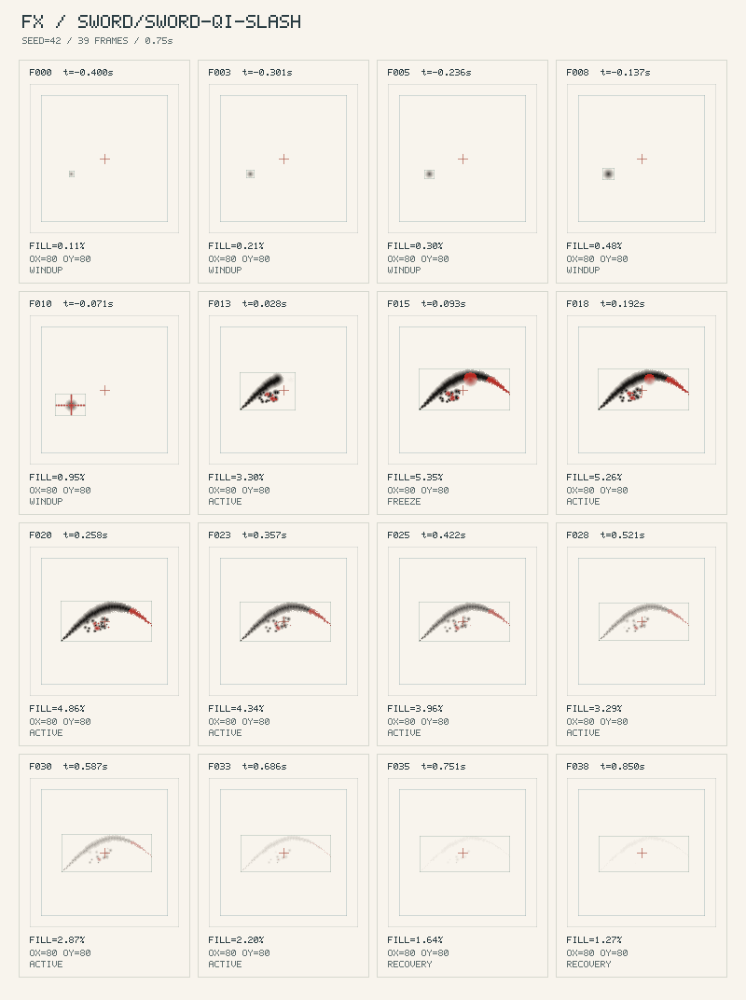
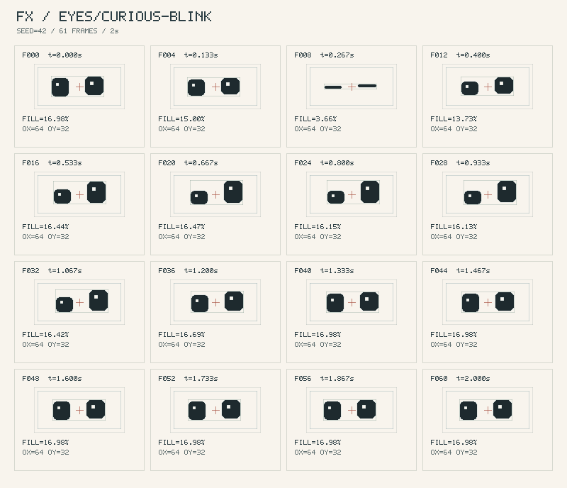

# fx-skill-kit · inkfx · oledfx

<p align="center"></p>

<p align="center">
  <a href="README.md">🇬🇧 English</a> ·
  <strong>🇹🇼 繁體中文</strong> ·
  <a href="https://malilion.github.io/fx-skill-kit/gallery/">🌐 GitHub Pages 線上展示館</a> ·
  <a href="docs/IMPLEMENTATION.md">📐 完整實作報告</a> ·
  <a href="docs/AUTHORING.md">✍️ 特效撰寫契約</a> ·
  <a href="docs/MCP.md">🔌 MCP 伺服器協定</a>
</p>

---

**零依賴程序化特效全套件：東方水墨與武俠引擎 (`inkfx`)、嵌入式 1-bit 與 RGB565 微螢幕編譯庫 (`oledfx`)、六大確定性品質守門員 (`CHK-01..06`)、Contact Sheet 視覺自檢與四個 stdio MCP 工具 (`fx-skill-kit`)。**



  

專為程序化素材開發者、獨立遊戲創作者、ESP32 創客與 AI Coding Agent 打造。撰寫精簡的確定性 JavaScript 特效，透過自動化檢查攔截工程缺陷，並渲染出多模態模型與人類都能一眼審查的時間軸接觸表（Contact Sheet）：**Draft → Check → Render → Look → Refine**。

---

## 🌐 GitHub Pages 線上雙界策展館與工作台

- **線上旗艦展示網址**：**[https://malilion.github.io/fx-skill-kit/gallery/](https://malilion.github.io/fx-skill-kit/gallery/)** *（程式碼儲存庫維持 `Private` 私有狀態，透過 GitHub Actions 自動驗證私有狀態並部署靜態 ESM 展示頁）*
- **五幕式「雙界策展（東方宣紙古籍 × 賽博硬體實驗室）」互動架構（支援獨立章節分頁與圖鑑分頁）**：
  1. **`01 STAGE` · 雙界共鳴互動主舞台**：左界宣紙畫布支援即時揮毫體驗「飛白與水暈（`Pigment + Wetness`）」雙緩衝物理與朱砂拔刀斬；右界擬真 0.96" I²C SSD1306 PCB 硬體模組中的機器雙眼即時凝視並追蹤游標，雙界點擊跨界共鳴。
  2. **`02 ANATOMY` · 水墨物理 × 1-Bit 演算法即時解剖劇場**：左軌即時拆解水墨四層緩衝（`01 Pigment 墨色`、`02 Wetness 水暈`、`03 Paper 宣紙紋`、`04 Composite 礦物合成`）與六階非線性礦物色階（`清·淡·重·濃·焦·點綴`）；右軌同步對照 `Bayer 4×4`、`Checker`、`Atkinson` 與 `Frame[t] ^ Frame[t-1]` **XOR-Delta 跨幀差分熱力圖**。
  3. **`03 ARCHIVE (32)` · 分頁式 32 組特效即時策展圖鑑牆**：搭載 `IntersectionObserver` 60fps 即時預覽、**13 組領域與分類篩選膠囊**、`⌘K` 即時搜尋，以及**圖鑑分頁器（支援每頁 `8` / `12` / `ALL (32)` 筆切換與 `← PREV / 01 / 02 / 03 / NEXT →` 頁碼導覽）**。
  4. **`04 STUDIO` · 深度調校艙與硬體模擬工作台**：支援宣紙卷軸與 SSD1306 藍光／白光／經典「上 16px 黃光＋下 48px 藍光」雙色區硬體面板切換、武俠四段時間軸（`WINDUP · ACTIVE · FREEZE · RECOVERY`）、`120Hz Step Budget` 即時效能波形、單檔 JS／React／Vue 複製，以及 PNG／Raw `.h`／ESP32 `XOR-RLE` C11 Header 下載。
  5. **`05 MCP LOOP` · AI Agent 視覺自檢閉環與 CLI 終端艙**：完整呈現 `CHK-01..06` 六道守門員規格與一鍵複製指令面板。
- **頂欄分頁導覽與雙語切換**：可自由切換 **全覽卷軸模式（`ALL 全覽`）** 或 **單章分頁視圖（`01 STAGE`–`05 MCP LOOP` 搭配底部前後章翻頁器）**、一鍵切換「宣紙 INK / 晶格 OLED」全域日夜材質，並支援 **`中/EN` 雙語並陳**、**`繁中`** 與 **`EN`** 三態即時切換。

---

## 📦 全目錄 32 組特效分類總表

內建目錄收錄 **32 組確定性特效**，涵蓋基礎入門 RGBA（`2` 組）、**InkFX 東方水墨與武俠**（`16` 組，完整涵蓋 6 大分類）以及 **OLEDFX 嵌入式微螢幕動畫**（`14` 組，完整涵蓋 5 大分類）：

| 領域 | 分類 (`category`) | 數量 | 收錄特效 ID |
| :--- | :--- | ---: | :--- |
| **Starter** | `starter` | 2 | `pulse-dot`, `orbit-loop` |
| **InkFX** | `sword` 劍氣與刀光 | 3 | `sword/sword-qi-slash`, `sword/cross-cleave`, `sword/myriad-swords` |
| **InkFX** | `talisman` 道家符籙與陣法 | 3 | `talisman/bagua-seal`, `talisman/cinnabar-burn`, `talisman/ink-chains` |
| **InkFX** | `zen` 禪意與自然物候 | 3 | `zen/bamboo-wind`, `zen/plum-blossom`, `zen/falling-sakura` |
| **InkFX** | `ink-burst` 墨韻爆發與受擊 | 3 | `ink-burst/heavy-impact`, `ink-burst/qi-surge`, `ink-burst/splash-guard` |
| **InkFX** | `transitions` 水墨轉場 | 2 | `transitions/brush-sweep`, `transitions/ink-drop-wash` |
| **InkFX** | `ui` 古風 UI 印記 | 2 | `ui/vermilion-seal`, `ui/realm-breakthrough` |
| **OLEDFX** | `eyes` 機器人雙眼表情 | 4 | `eyes/happy-squint`, `eyes/curious-blink`, `eyes/cyber-charge`, `eyes/dizzy-spiral` |
| **OLEDFX** | `weather` 像素天氣與環境 | 3 | `weather/rain-storm`, `weather/sunny-orbit`, `weather/snow-drift` |
| **OLEDFX** | `system` 系統狀態與遙測 | 3 | `system/wifi-pulse`, `system/battery-charge`, `system/cpu-wave` |
| **OLEDFX** | `pomodoro` 專注計時與生活 | 2 | `pomodoro/hot-coffee`, `pomodoro/hourglass-flip` |
| **OLEDFX** | `transitions` 微螢幕硬體轉場 | 2 | `transitions/crt-off`, `transitions/venetian-blinds` |
| **合計** | **11 大分類** | **32** | **全數 100% 通過 `CHK-01..06`（Seed 42）** |

---

## 🚀 快速開始與 CLI 工具鏈

需要 Node.js 20 或更新版本。零外部套件、免安裝建置。

```sh
npm test
npm run check
npm run check -- sword/sword-qi-slash eyes/curious-blink --seed 42
npm run render -- sword/sword-qi-slash --seed 42 --sheet --gif
npm run act -- sword/sword-qi-slash --seed 42
npm run export-sheet -- sword/sword-qi-slash --palette zhusha --paper
npm run export-mcu -- eyes/curious-blink --profile ssd1306-128x64 --fps 24 --compress xor-rle
npm run export-mcu -- sword/sword-qi-slash --profile st7789-128x128 --fps 15 --compress xor-rle
npm run showcase

npm run gallery
# 開啟 http://127.0.0.1:8080/gallery/
```

建立自己的效果，然後執行檢查與視覺自檢：

```sh
npm run new -- ui/my-pulse --loop --sim
npm run check -- ui/my-pulse --seed 42
npm run render -- ui/my-pulse --seed 42
npm run act -- ui/my-pulse --seed 42
```

- **水墨遊戲引擎匯出器 (`tools/export-sheet.mjs`)**：支援輸出透明背景 (`sheet.png`) 或宣紙紋理底色 (`--paper`、`sheet-paper.png`)，並附帶相容 Aseprite / Godot / Phaser 的 JSON Atlas（內含 `meta.inkfx.act` 武俠蓄力與頓幀時間點）與四大傳統六階礦物色盤（`songyan` 松煙、`zhusha` 朱砂、`shiqing` 石青、`nijin` 泥金）。
- **微控制器硬體匯出器 (`tools/export-mcu.mjs`)**：支援 `ssd1306-128x64`、`ssd1306-128x32`、`led-matrix-64x32`、`st7789-128x128` 等硬體規格預設集。`--compress xor-rle` 採用 SSD1306 原生垂直 Page 佈局與 `XOR-Delta + RLE` 差分壓縮（將 49 KB 原始幀壓縮至 `< 3.6 KB`，節省 93%+ Flash 空間），並內建零動態記憶體配置（Zero-malloc）的 1-bit `oledfx_step_frame` 與 16-bit `oledfx_step_rgb565_frame` C11 解碼器；同時支援 `--compress xbm` 與 `--compress adafruit`。

---

## 🔌 Stdio MCP 伺服器 (`tools/mcp-server.mjs`)

在儲存庫用 `npm run mcp` 啟動 stdio MCP 伺服器（用戶端請設定直接執行 `node tools/mcp-server.mjs`）：

| 工具 | 結果 |
| :--- | :--- |
| `fx_search_catalog(query?, category?)` | 依 ID、標籤與分類對全 32 組特效做本地關鍵字排序搜尋 |
| `fx_render_contact_sheet(effect_id, palette?)` | 回傳 Base64 PNG 時間軸分格圖塊與產物路徑 |
| `fx_run_diagnostics(effect_id)` | 回傳 `CHK-01..06` 結構化診斷報告（種子 42） |
| `fx_export_asset(effect_id, target_format, palette?)` | 匯出 `sheet`、`gif`、`png` 或 `c-header` 產物路徑 |

---

## 🖼️ Contact Sheet 視覺審查範例

**水墨劍氣斬擊 (`sword/sword-qi-slash`)：** 含負時間軸壓身蓄力（`-0.12s`）、朱砂寒光、飛白劍氣弧線、命中頓幀（`0.08s` Hit-stop）與甩墨水暈。



**好奇歪頭眨眼 (`eyes/curious-blink`)：** `128×64` 1-bit 參數化雙眼與視線追蹤，經 `export-mcu.mjs` XOR-RLE 壓縮後由 `49,152 Bytes` 降至 `3,333 Bytes`（節省 `93.2%`）。



中繼資料、緩衝區、種子與檢查契約見 [AUTHORING.md](docs/AUTHORING.md)。AI Agent 請遵循 [FX 撰寫技能](skills/fx-authoring/SKILL.md) 執行視覺自檢閉環。
