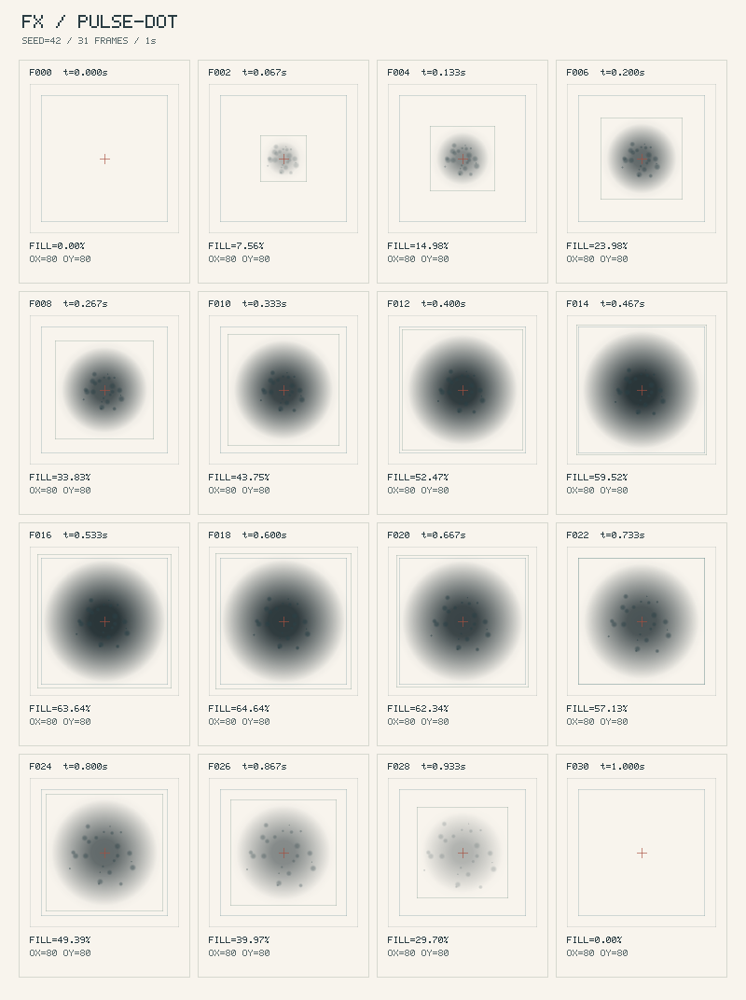
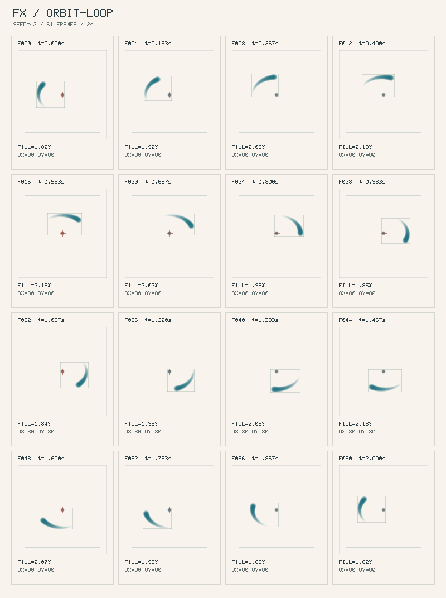

# fx-skill-kit

<p align="center"></p>

[English](README.md) · **繁體中文**

**零依賴的程序化特效製作：六項品質檢查、視覺檢視、sprite／GIF 匯出，以及四個 MCP 工具。**


給製作程序化素材的人，以及撰寫程式代理的人。效果是可重現的 RGBA。先寫一小段 JavaScript，檢查它的行為，再渲染一張你可以親自判斷的分格圖（contact sheet）。人和程式代理走同一條迴圈：**起草 → 檢查 → 渲染 → 觀看 → 修改**。

它會抓到未設種子的隨機與時鐘、邊緣溢出、斷掉的循環接縫、空白幀，以及畫太慢。選用的領域外掛可以加上專案自己的檢查。每一格分格圖都有幀編號、經過秒數、填色百分比、安全區和原點十字。旁邊的 JSON 保留完整精度的耗時與幀統計。

入門目錄有 **2 個效果**，都在 `src/catalog.json` 裡標成未分類。這是工具組的起點，沒有再綁一套更大的特效庫。

| 目錄分類 | 效果數 |
| --- | ---: |
| 未分類（`orbit-loop`、`pulse-dot`） | 2 |
| **合計** | **2** |

## 試一次

需要 Node.js 20 或更新版本。不用安裝套件，也不用建置。

```sh
npm test
npm run check
npm run check -- pulse-dot --seed 42
npm run render -- pulse-dot --seed 42 --sheet --gif --out artifacts/pulse-dot
npm run act -- orbit-loop --seed 42 --out artifacts/orbit-loop
# 開啟 artifacts/pulse-dot/contact.png 與 artifacts/orbit-loop/act-strip.png

npm run gallery
# 開啟 http://127.0.0.1:8080/gallery/
```

建立自己的效果，然後檢查並查看：

```sh
npm run new -- ui/my-pulse --loop --sim
npm run check -- ui/my-pulse --seed 42
npm run render -- ui/my-pulse --seed 42
npm run act -- ui/my-pulse --seed 42
```

腳手架會寫入 `src/fx/<category/name>.js` 並更新 `src/catalog.json`。工具接受目錄 ID 或 JS 路徑。`act` 以每秒 12 幀把樣本寫到 `records/<id>/act-strip.png` 和 JSON；效果若有 `act` 中繼資料，會包含負向的蓄力與回復。`render --out examples/out/<id>` 仍支援較早的輸出位置。

用 `npm run render -- orbit-loop --sheet --gif --seed 42` 匯出每一個播放幀。`sheet.png` 是透明的，沒有標註；`sheet.json` 是陣列圖集，含每幀矩形、毫秒長度、原點、種子、是否循環，以及 act 中繼資料。`preview.gif` 不依賴外部套件，使用 216 色盤與透明。GIF 以百分之一秒計時，並使用字面 LZW，所以檔案偏大、作法單純；半透明會先合成到紙色上。循環會省掉重複的終點幀。`--palette zhusha`（或一組十六進位色碼的 JSON 陣列）會傳給效果；`--multi-angle` 會為有實作這些輸入的模組渲染九組 `(tiltX, tiltY)` 視角。

在這個儲存庫用 `npm run mcp` 啟動 stdio MCP 伺服器（請把用戶端設成直接執行 `node tools/mcp-server.mjs`）。它提供：

| 工具 | 結果 |
| --- | --- |
| `fx_search_catalog(query?, category?)` | 依 ID、標籤與中繼資料做本地關鍵字排序 |
| `fx_render_contact_sheet(effect_id, palette?)` | PNG 圖塊與產物路徑 |
| `fx_run_diagnostics(effect_id)` | CHK-01..06 結構化報告，種子 42 |
| `fx_export_asset(effect_id, target_format, palette?)` | `sheet`、`gif`、`png` 或 `c-header` 的產物路徑 |

見 [MCP 設定與協定](docs/MCP.md)。不需要 MCP SDK 或 npm 套件。C header 是未壓縮的 SSD1306 直向頁，來自 alpha 遮罩；硬體專用的壓縮管線屬於 oledfx 匯出器。

檢查預設使用種子 42。邊緣占用必須低於 1.5%（轉場除外）。循環接縫比較 `t=0` 與 `duration − 1/fps`，MSE 和質心位移都要落在相鄰幀中位數變化的 1.5 倍以內。有效內容開頭與結尾的空白各不得超過 15%；效果必須變成可見（填色 0.2%），且不能整段都超過 85% 填色。暖機之後，120Hz 跑 300 步，p95 須小於 1.5ms、最大值須小於 3ms。不穩定的 CI 可用 `--perf-soft` 改成警告，或設 `FX_CHECK_PERF=0` 跳過計時。`check --json` 輸出機器可讀報告。把 `fx.config.example.js` 複製成 `fx.config.js` 即可登記領域檢查；內建可重用的墨色熵、獨立 OLED 閃爍，以及 XOR-RLE 大小檢查。

## 你會看到什麼

**脈衝點：** 一團有種子的柔和墨色，綻開再淡去。



**軌道循環：** 一顆粒子和淡出的尾跡，回到起始相位。



由左到右、由上到下讀。十字標的是效果原點；填色百分比是標註之前的效果本身。第一格和最後一格都包含時間軸的兩個端點。加上 `--frames 31` 可以看更多時刻，或用 `--out path/to/review` 指定輸出目錄。

## 動起來的預覽

Gallery 以效果自己的幀尺寸在畫布上播放。可以切換色盤、拖曳預覽或設定 view/tilt、複製該效果的原始碼，並下載目前這一幀的 PNG 與 C header。種子、重播、暫停和原點參考線都在同一頁。若這份 HTML 是用 file: 網址打開的，頁面會說明要改怎麼把這個儲存庫提供出來。

中繼資料、RGBA 緩衝、種子與檢查契約見 [AUTHORING.md](docs/AUTHORING.md)。代理可以跟著 [FX 撰寫技能](skills/fx-authoring/SKILL.md)，把視覺檢查留在迴圈裡。`.claude-plugin/plugin.json` 會載入這個技能。

核心工具是純 ESM，只用 Node 內建模組，零執行期依賴。

指令失敗時，請用 Node.js 20 以上，並在儲存庫根目錄執行，目錄 ID 才找得到。未知 ID 會列出可用的目錄項目；本地模組可以直接傳 `.js` 或 `.mjs` 路徑。若 8080 埠已被占用，請在上面的 gallery 指令之前把 `PORT` 設成一個空閒埠。
